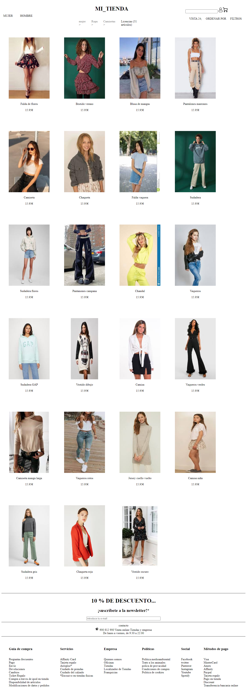

# Maquetación · Tienda de moda

Maquetación de la portada de una tienda de moda online, inspirada en Pull&Bear hecha desde cero con HTML y CSS, como ejercicio para practicar el diseño de páginas a partir de una web real.

**Ver online:** https://serberar.github.io/ej3-tienda/

## Qué se practica

- Menú de navegación con submenús desplegables en `:hover`.
- Rejilla de productos con Flexbox y `flex-wrap`.
- Cabecera con buscador e iconos de usuario y carrito.
- Pie de página con contacto y enlaces.

## Cómo verlo

Abre `index.html` en el navegador o entra en la versión publicada.

## Autor

Sergio Bernabé
